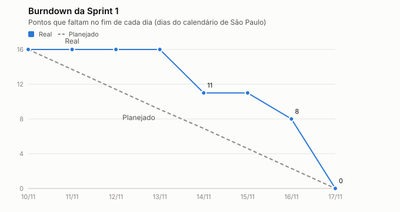
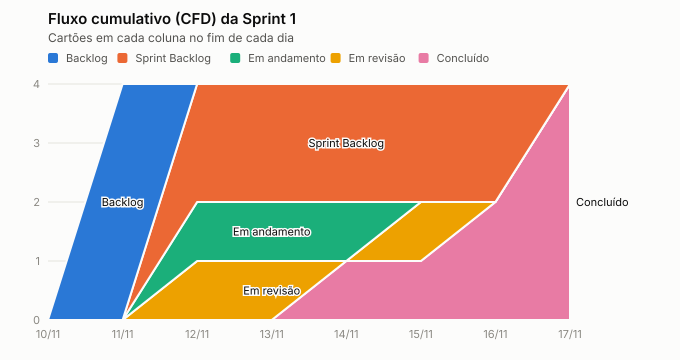

# Métricas da Sprint 1 (10/11 a 17/11/2026)

Histórias planejadas: H1 a H4 (#1 a #4), 16 pontos.
Dados: `docs/metricas/sprint-1.json`, coletados do GitHub em 17/11/2026.
Para refazer a conta: `node scripts/metricas.mjs docs/metricas/sprint-1.json`.

## Resultado

| Métrica | Valor | Como foi calculada |
|---|---|---|
| **Lead Time** médio | **5,0 dias** | Dia em que a issue fechou − dia em que ela foi criada, em dias corridos do calendário de São Paulo; média das 4 histórias: (3 + 5 + 6 + 6) / 4 |
| **Cycle Time** médio | **2,25 dias** | Dia em que a issue fechou − campo **Início** do board; média: (2 + 4 + 1 + 2) / 4 |
| **Throughput** | **4 histórias** | Histórias fechadas dentro da Sprint (4 de 4 planejadas) |
| **Velocity** | **16 pontos** | Soma dos pontos das histórias fechadas: 5 + 3 + 5 + 3 (16 de 16 planejados) |
| **Burndown** | gráfico abaixo | Pontos que faltam no fim de cada dia: 16 − pontos das histórias já fechadas |
| **CFD** | gráfico abaixo | Cartões H1 a H4 em cada coluna no fim de cada dia, pelo histórico de status do board |

### Conta de cada história

| História | Pontos | Criada | Início | Fechada | Lead Time | Cycle Time |
|---|---|---|---|---|---|---|
| #1 H1 · Conta e board | 5 | 11/11 | 12/11 | 14/11 | 3 dias | 2 dias |
| #2 H2 · Convite | 3 | 11/11 | 12/11 | 16/11 | 5 dias | 4 dias |
| #3 H3 · Cartões e histórico | 5 | 11/11 | 16/11 | 17/11 | 6 dias | 1 dia |
| #4 H4 · Limite de WIP | 3 | 11/11 | 15/11 | 17/11 | 6 dias | 2 dias |

"Fechada" é o dia em que o PR foi mesclado e a issue fechou. As datas do GitHub vêm em UTC e foram
convertidas para o dia de São Paulo. Por exemplo, a #1 fechou em 15/11 às 01h42 UTC, que é
**14/11 às 22h42 em São Paulo**.

## Burndown



| Dia | 10/11 | 11/11 | 12/11 | 13/11 | 14/11 | 15/11 | 16/11 | 17/11 |
|---|---|---|---|---|---|---|---|---|
| Planejado | 16 | 13,7 | 11,4 | 9,1 | 6,9 | 4,6 | 2,3 | 0 |
| Real | 16 | 16 | 16 | 16 | 11 | 11 | 8 | 0 |

A linha planejada desce em linha reta de 16 (primeiro dia) até 0 (último dia): 16 × (1 − dia/7).

## CFD (fluxo cumulativo)



| Dia | Backlog | Sprint Backlog | Em andamento | Em revisão | Concluído |
|---|---|---|---|---|---|
| 10/11 | 0 | 0 | 0 | 0 | 0 |
| 11/11 | 4 | 0 | 0 | 0 | 0 |
| 12/11 | 0 | 2 | 1 | 1 | 0 |
| 13/11 | 0 | 2 | 1 | 1 | 0 |
| 14/11 | 0 | 2 | 1 | 0 | 1 |
| 15/11 | 0 | 2 | 0 | 1 | 1 |
| 16/11 | 0 | 2 | 0 | 0 | 2 |
| 17/11 | 0 | 0 | 0 | 0 | 4 |

Cada cartão conta na última coluna para onde foi movido até o fim do dia. As issues foram criadas
em 11/11, por isso o board está vazio em 10/11.

## O que os números dizem

- **Tudo planejado foi entregue (16 de 16 pontos), mas no fim.** O burndown ficou acima da linha
  planejada a Sprint inteira, e **11 dos 16 pontos fecharam nos dois últimos dias** (H2 em 16/11,
  H3 e H4 em 17/11). Qualquer atraso no último dia teria deixado história de fora.
- **O trabalho esperou mais do que andou.** O Lead Time médio (5 dias) é mais que o dobro do Cycle
  Time (2,25 dias). Pelo CFD, a faixa de "Sprint Backlog" fica parada com 2 cartões (H3 e H4) de 12/11
  a 16/11: elas esperavam a H1 e a H2, porque dependiam do board e dos membros.
- **A revisão foi um gargalo na H1.** A H1 ficou de 12/11 a 14/11 em "Em revisão" (duas rodadas de
  revisão e correções). Na H2, foi 1 dia. O WIP de "Em andamento + Em revisão" não passou de 2.

## Cuidados com os dados (para a defesa)

- **O Início da H3 (16/11) e o da H4 (15/11) foram gravados à mão.** A Action `board.yml` falhou por
  falta de escopo no token, corrigido em 17/11. As datas usadas são as do push de cada branch.
- **O CFD usa o histórico de status do board, e não o campo Início.** Por isso, ele mostra a H3 em
  "Em andamento" só por alguns minutos de 17/11 (quando a issue foi movida à mão). A H1 foi direto de
  "Backlog" para "Em revisão" em 12/11, sem passar por "Em andamento" no board.
- **O Sprint Planning foi registrado no board em 12/11**, e não em 10/11. Por isso as histórias saem do
  "Backlog" só nesse dia.
- **A conferir com o time:** pelo log das sessões, a H1 começou em 11/11, mas o campo Início diz 12/11.
  O código da H2 começou em 14/11 (depois do merge da H1), mas o Início é 12/11. Se o time corrigir
  essas datas no board, basta coletar os dados de novo e rodar o script.

## Como os dados foram coletados

```bash
# datas de criação e fechamento das issues
gh issue list --state all --label história --json number,title,createdAt,closedAt
# campos Pontos e Início do board
gh project item-list 3 --owner PauloAV --format json
# histórico de status (coluna) de cada issue no board, pela API GraphQL:
# timelineItems(itemTypes: [PROJECT_V2_ITEM_STATUS_CHANGED_EVENT]) { createdAt status }
```
